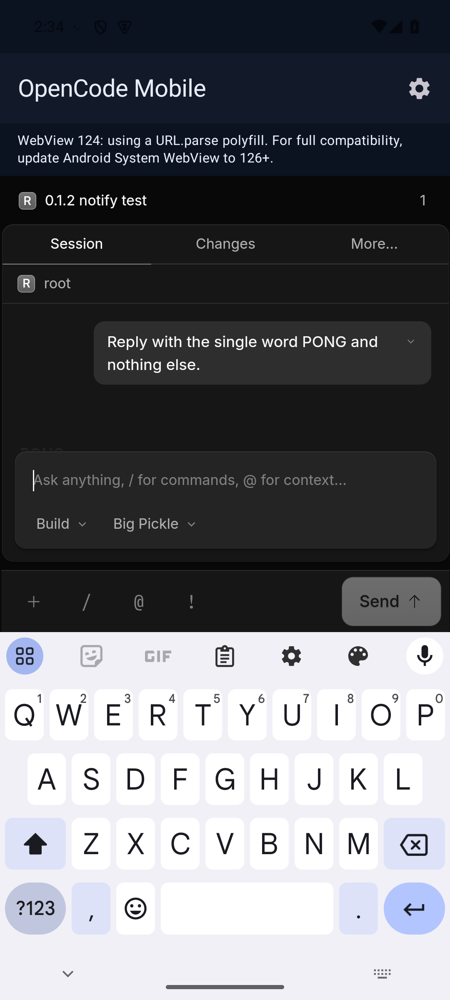

# OpenCode Mobile

Unofficial Android client for [OpenCode](https://opencode.ai). **This is not a product of the OpenCode team** and is not affiliated with Anomaly, SST, or opencode.ai.

The app runs the official Linux `opencode serve` binary (linux-arm64 or linux-x64) inside an Ubuntu 24.04 PRoot environment and shows the **official web UI** in a WebView. A built-in Phone API (Termux:API-compatible command names plus an MCP server named `phone`) lets the agent use device sensors and features.

Package: `ru.dredd20.opencode`. Current release: **0.1.2** (versionCode 3). Builds in this tree are **debug**.

[Русский README](README.md) · [Changelog](CHANGELOG.md) · [Third-party notices](NOTICE)

## What 0.1.x includes

- Embedded mode: Ubuntu 24.04 + official OpenCode 2.3.0 under PRoot, web UI sign-in without typing the serve password (native `/api/pair` + `/auth/connect/{code}`).
- Termux and Remote modes (connect to an already running `opencode serve`).
- Phone API and MCP `phone` (battery, sensors, torch, clipboard, toast, TTS, share, USB list, and more). Sensitive categories (location, camera, SMS/contacts) are off by default.
- “Agent reply is ready” notification when the app is in the background and a turn finishes (`session.idle` / `session.execution.succeeded`).
- Phone and tablet layouts (two-column settings at width ≥ 840 dp).

Intentionally **not** in v0.1: an in-app agent browser, raw USB fd passing (`termux-usb -e` / SCM_RIGHTS), release signing, or store publication.

## Install

Distributed as a debug APK, not via Google Play. You can install over a previous 0.1.x build that uses the same signing certificate.

1. Download `opencode-mobile-0.1.2-debug.apk` from [Releases](https://github.com/winnifredbalistreri60-prog/opencode-mobile/releases) (once a release is published) or build it yourself.
2. Allow installation from the chosen source and install the package.
3. On the Setup screen, accept the unofficial-client disclaimer and tap **Install**. This needs a network connection and about 150 MB down / ~800 MB on disk (ubuntu-base + the OpenCode CLI).
4. When you see “Ready: OpenCode 2.3.0”, tap **Start**. The official web UI opens.

You should not have to type the serve password into the page. Do not publish `serve-state.json`, `last-serve.json`, or `local.properties`.

### Upgrading

0.1.2 installs over 0.1.1 / 0.1.0 when the certificate matches (SHA-256 `65b96eb07abe416771b1a8c96184d87641d2e1cf51954ec340d40d34b32d2a90` for these debug builds). The rootfs is kept. Phone API scripts are refreshed on every Start.

### Termux mode

1. Install Termux from F-Droid (or the official APK for your ABI). The Play Store Termux build is not suitable.
2. Add `allow-external-apps=true` to `~/.termux/termux.properties` and run `termux-reload-settings`.
3. Grant OpenCode Mobile the `RUN_COMMAND` permission.
4. In app settings, select Termux mode and Start. If Termux is missing, the UI shows instructions instead of waiting forever.

Switching mode stops the previous mode’s server (after a confirmation).

### Remote mode

Enter a complete URL (`http://host:port` or `https://…`). Incomplete values such as `http://` are rejected. Non-loopback `http://` shows a cleartext warning.

## Build from source

You need JDK 17+, the Android SDK (API 35/36), and (for emulator work) an x86_64 AVD.

The debug keystore is **not** in git. Place it outside the repository and point to it from gitignored `local.properties`:

```
sdk.dir=/path/to/android-sdk
debug.keystore=/path/to/debug-v0.1.keystore
```

Or set `OPENCODE_DEBUG_KEYSTORE`. If neither is set, Gradle falls back to the default Android debug key (the signature will not match an already installed 0.1.x build).

```bash
./gradlew assembleDebug testDebugUnitTest
# APK: app/build/outputs/apk/debug/app-debug.apk
```

Do not commit `local.properties`, `*.keystore`, `*.jks`, or `build/` / `.gradle/` directories.

## Screenshots

| Web UI after upgrade | Model reply | Reply-ready notification |
| --- | --- | --- |
|  |  |  |

## Docs

- [CHANGELOG.md](CHANGELOG.md) — 0.1.0, 0.1.1, 0.1.2
- [CHANGES.md](CHANGES.md) — detailed tester-bug notes for the current release
- [TESTPLAN.md](TESTPLAN.md) — how to verify
- [NOTICE](NOTICE) / [THIRD_PARTY.md](THIRD_PARTY.md) — third-party licenses
- [LICENSE](LICENSE) — MIT, with attribution to [anomalyco/opencode](https://github.com/anomalyco/opencode)

## Issues

Please use the [issue templates](.github/ISSUE_TEMPLATE). Do not attach passwords, keystores, or `local.properties`. Bugs in the OpenCode CLI or web UI itself belong [upstream](https://github.com/anomalyco/opencode).

## License

Client code is MIT, © 2026 OpenCode Mobile contributors. OpenCode is MIT, © 2025 opencode / Anomaly. PRoot (Termux fork) is GPL-2.0-or-later; talloc is LGPL-3.0-or-later. See `NOTICE` for details.
