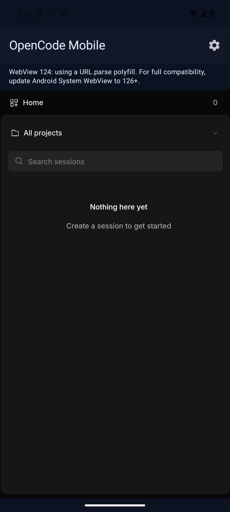
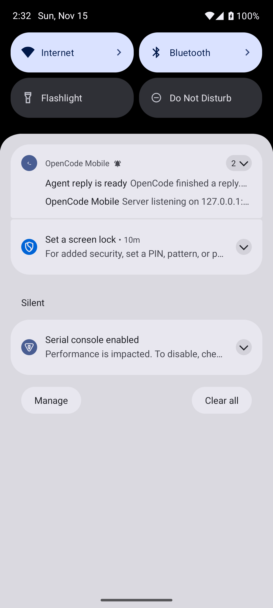
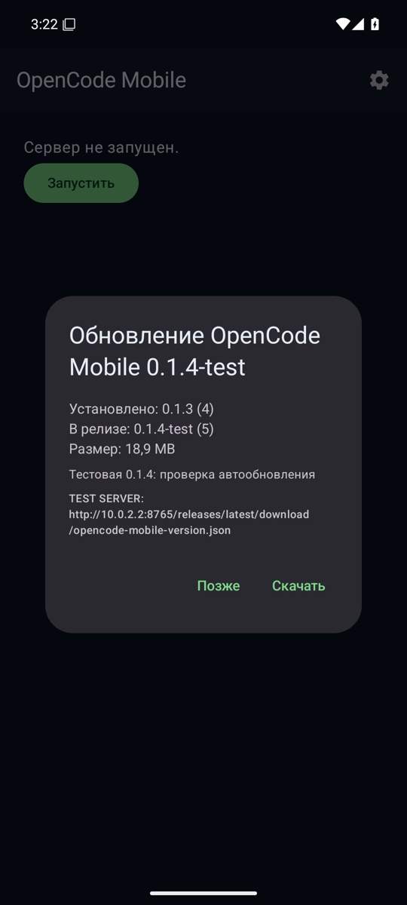
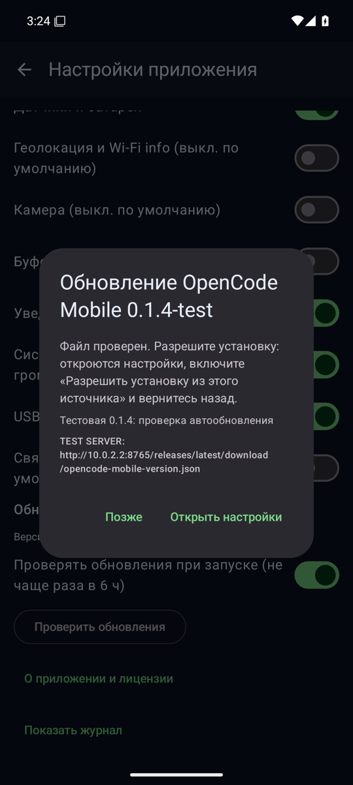
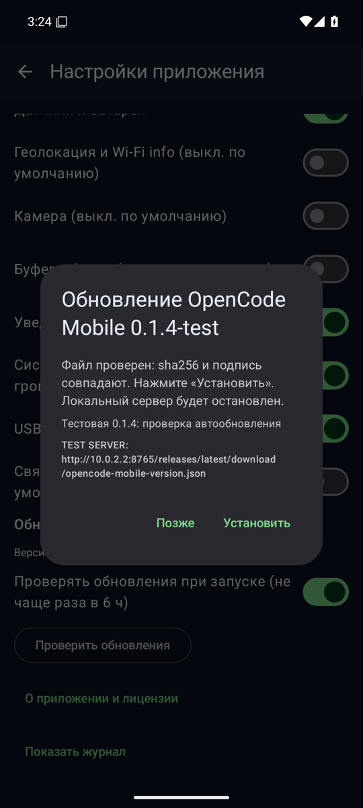
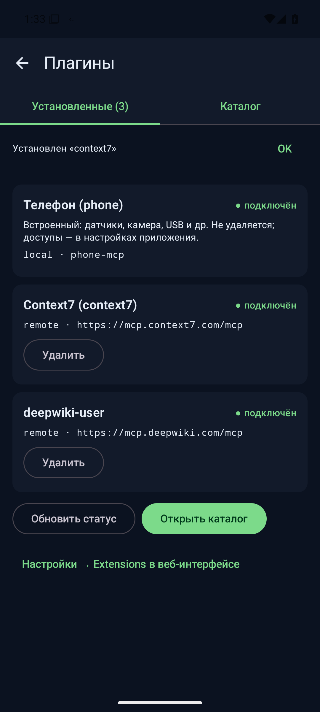
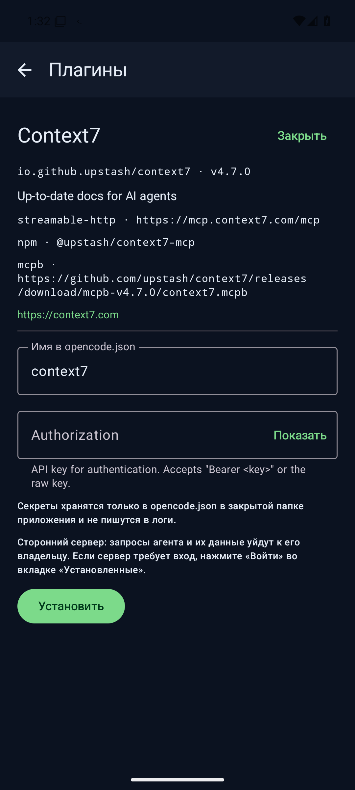
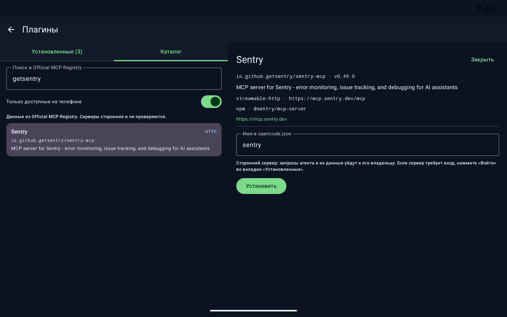

# OpenCode Mobile

Unofficial Android client for [OpenCode](https://opencode.ai). **This is not a product of the OpenCode team** and is not affiliated with Anomaly, SST, or opencode.ai.

The app runs the official Linux `opencode serve` binary (linux-arm64 or linux-x64) inside an Ubuntu 24.04 PRoot environment and shows the **official web UI** in a WebView. A built-in Phone API (Termux:API-compatible command names plus an MCP server named `phone`) lets the agent use device sensors and features.

Package: `ru.dredd20.opencode`. Current release: **0.2.1** (versionCode 11). Builds in this tree are **debug**.

[Русский README](README.md) · [Changelog](CHANGELOG.md) · [Third-party notices](NOTICE)

## What 0.2.x includes

- Embedded mode: Ubuntu 24.04 + official OpenCode 2.3.0 under PRoot, web UI sign-in without typing the serve password (native `/api/pair` + `/auth/connect/{code}`).
- Termux and Remote modes (connect to an already running `opencode serve`).
- Phone API and MCP `phone` (battery, sensors, torch, clipboard, toast, TTS, share, USB list, and more). Sensitive categories (location, camera, SMS/contacts) are off by default.
- “Agent reply is ready” notification when the app is in the background and a turn finishes (`session.idle` / `session.execution.succeeded`).
- Phone and tablet layouts (two-column settings at width ≥ 840 dp).
- In-app updates from this repository's GitHub Releases (since 0.1.3): sha256 and signature checks, system installer.
- **Plugins (since 0.2.0).** A “Plugins” screen (puzzle icon in the top bar, or App settings → Plugins): a catalog of remote MCP servers from the Official MCP Registry with search, cache and offline mode, one-tap install (written to `opencode.json` and connected right away), removal, an installed list with live status, and fields for headers/API keys. For OAuth, “Sign in” opens Settings → Extensions → MCP in the web UI. The built-in `phone` server cannot be removed.
- `opencode.json` is no longer overwritten on setup or start: the app only merges its own keys (`update`, `mcp.servers.phone`) and keeps your MCP servers, plugins and settings. A broken file is kept as `opencode.json.broken-<time>.bak`.

Not yet included: local MCP via npx/uvx (no Node.js or uv in the environment; such servers are marked “not available yet” in the catalog), SSE-only servers (OpenCode 2.3 connects remote MCP over Streamable HTTP), OAuth sign-in through Custom Tabs (stage 2), an in-app agent browser, raw USB fd passing (`termux-usb -e` / SCM_RIGHTS), release signing, or store publication.

## Install

Distributed as a debug APK, not via Google Play. You can install over a previous 0.1.x build that uses the same signing certificate.

1. Download `opencode-mobile-0.2.1.apk` from [Releases](https://github.com/winnifredbalistreri60-prog/opencode-mobile/releases) (once a release is published) or build it yourself.
2. Allow installation from the chosen source and install the package.
3. On the Setup screen, accept the unofficial-client disclaimer and tap **Install**. This needs a network connection and about 150 MB down / ~800 MB on disk (ubuntu-base + the OpenCode CLI).
4. When you see “Ready: OpenCode 2.3.0”, tap **Start**. The official web UI opens.

You should not have to type the serve password into the page. Do not publish `serve-state.json`, `last-serve.json`, or `local.properties`.

### Upgrading

**In-app (since 0.1.3).** On launch, at most every 6 hours, the app reads
`https://github.com/winnifredbalistreri60-prog/opencode-mobile/releases/latest/download/opencode-mobile-version.json`
(fallback: the public GitHub API `releases/latest`, no token). When the manifest `versionCode` is higher than the
installed one, a dialog appears. Manual check: **App settings → App updates → Check for updates**, next to the
auto-check switch.

Before installing, the app verifies that the APK URL belongs to this repository's releases, the size and sha256 from
the manifest, the package name, `versionCode`, and that the signing certificate matches the installed app. Any mismatch
deletes the file and rejects the update. Installation uses the system PackageInstaller, so Android asks for
confirmation. Without the “Install unknown apps” permission, “Open settings” opens the right page; after you enable
“Allow from this source” and come back, the dialog switches to “Install” by itself. The local server is stopped before
installing. Data (rootfs, settings) is kept.

**Manually.** A new version installs over 0.2.x / 0.1.x when the certificate matches (SHA-256 `65b96eb07abe416771b1a8c96184d87641d2e1cf51954ec340d40d34b32d2a90` for these debug builds). The rootfs is kept. Phone API scripts are refreshed on every Start.

### Termux mode

You need an **arm64** phone and Termux from F-Droid or GitHub (the Play Store build is not suitable). The official OpenCode Linux build is linked against glibc while Termux uses Bionic, so `npm i -g opencode-ai` does not work in Termux. The install script:

- installs Termux's own glibc (`glibc-repo`, `glibc-runner`) and `patchelf`;
- downloads the official `opencode-linux-<arch>.tar.gz` from GitHub and checks its sha256 (pinned in the script for 2.3.0);
- patches only the ELF interpreter to `$PREFIX/glibc/lib/ld-linux-*.so` (no RPATH change: that breaks the bundled payload);
- adds an `opencode` command to `$PREFIX/bin` (clears `LD_PRELOAD` and runs the binary directly);
- sets `allow-external-apps=true` and runs `termux-reload-settings`.

Steps:

1. Install Termux and open it once.
2. In OpenCode Mobile: App settings → Mode: Termux → **Copy install command**. In Termux long-press → Paste, then Enter. The script is saved as `~/ocm-termux-install.sh`; running it again is safe and updates the binary.
   The same script is `scripts/termux-install.sh` in the repo. Once 0.2.1 is in `main` you can also run:
   `curl -fsSL https://raw.githubusercontent.com/winnifredbalistreri60-prog/opencode-mobile/main/scripts/termux-install.sh | bash`
3. Allow the app to “Run commands in Termux” (button on screen or Android Settings → Apps → OpenCode Mobile → Permissions).
4. Tap Start. The server password goes through stdin and a 0600 file in `~/.opencode-mobile/`, never through arguments. Stop ends only our `opencode serve` (by pid and port). If start fails, the Termux error (stderr and exit code) is shown on screen and written to `termux.log`.

Limitation: on x86_64 Android (emulators, some Chromebooks) seccomp kills the glibc loader (`Bad system call`, exit 159). Use the built-in mode there.

Switching mode stops the previous mode’s server (after a confirmation).

### Remote mode

Enter a complete URL (`http://host:port` or `https://…`). Incomplete values such as `http://` are rejected. Non-loopback `http://` shows a cleartext warning.

## Build from source

You need JDK 17+, the Android SDK (API 35/36), and (for emulator work) an x86_64 AVD.

The debug keystore is **not** in git. Place it outside the repository and point to it from gitignored `local.properties`:

```
sdk.dir=/path/to/android-sdk
debug.keystore=/path/to/debug-v0.1.keystore
```

Or set `OPENCODE_DEBUG_KEYSTORE`. If neither is set, Gradle falls back to the default Android debug key (the signature will not match an already installed 0.1.x build).

```bash
./gradlew assembleDebug testDebugUnitTest
# APK: app/build/outputs/apk/debug/app-debug.apk
```

Do not commit `local.properties`, `*.keystore`, `*.jks`, or `build/` / `.gradle/` directories.

### Cutting a release (maintainers)

`scripts/make-release.sh` builds the APK, checks the signing certificate, computes sha256, and writes
`dist/v<version>/opencode-mobile-<version>.apk`, `.sha256` and `opencode-mobile-version.json`. It publishes nothing.
Upload both the APK and `opencode-mobile-version.json` to release `v<version>` and mark it latest.
The script refuses test builds made with `-PocmUpdateTestServer=http://…` (local update server).

## Screenshots

| Web UI after upgrade | Model reply | Reply-ready notification |
| --- | --- | --- |
|  |  |  |

| Update found | Permission needed | After granting it |
| --- | --- | --- |
|  |  |  |

### Plugins (MCP)

- The catalog comes from the [Official MCP Registry](https://registry.modelcontextprotocol.io) (`/v0.1/servers`, latest versions only). These are third-party servers and the registry does not vet them: agent requests go to the server's owner.
- By default only servers that can run on the phone (remote Streamable HTTP) are shown. “Only available on the phone” off shows the rest with a reason.
- In embedded mode an install is saved to `/root/.config/opencode/opencode.json` in the app's private folder (mode 0600) and survives server restarts and APK updates. Header values (API keys) are stored only there and never logged.
- In Termux and Remote modes the server config is not the app's: an install lasts until the server restarts.

| Installed | Server card | Tablet |
| --- | --- | --- |
|  |  |  |

## Docs

- [CHANGELOG.md](CHANGELOG.md) — 0.1.0, 0.1.1, 0.1.2
- [CHANGES.md](CHANGES.md) — detailed tester-bug notes for the current release
- [TESTPLAN.md](TESTPLAN.md) — how to verify
- [NOTICE](NOTICE) / [THIRD_PARTY.md](THIRD_PARTY.md) — third-party licenses
- [LICENSE](LICENSE) — MIT, with attribution to [anomalyco/opencode](https://github.com/anomalyco/opencode)

## Issues

Please use the [issue templates](.github/ISSUE_TEMPLATE). Do not attach passwords, keystores, or `local.properties`. Bugs in the OpenCode CLI or web UI itself belong [upstream](https://github.com/anomalyco/opencode).

## License

Client code is MIT, © 2026 OpenCode Mobile contributors. OpenCode is MIT, © 2025 opencode / Anomaly. PRoot (Termux fork) is GPL-2.0-or-later; talloc is LGPL-3.0-or-later. See `NOTICE` for details.
