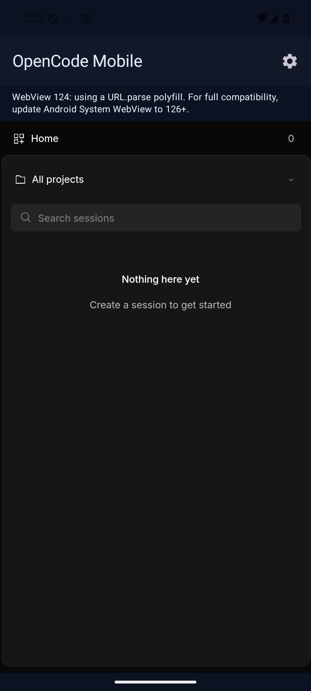
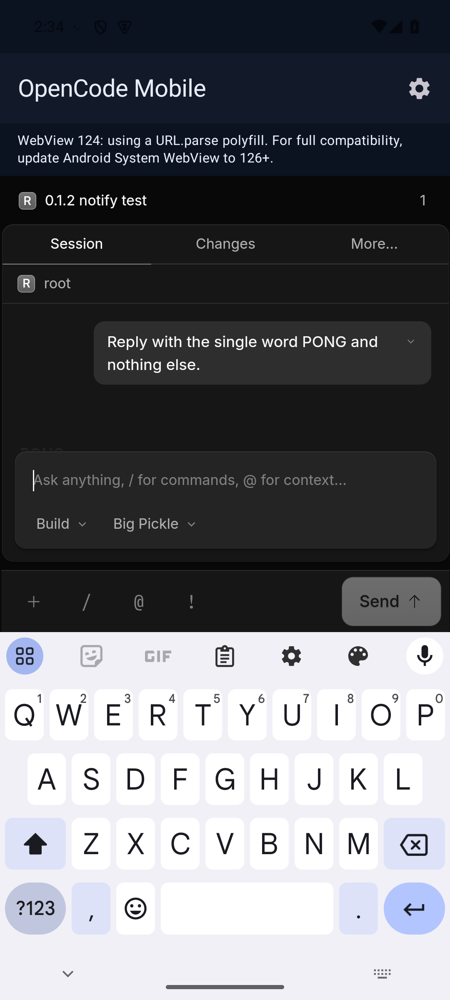
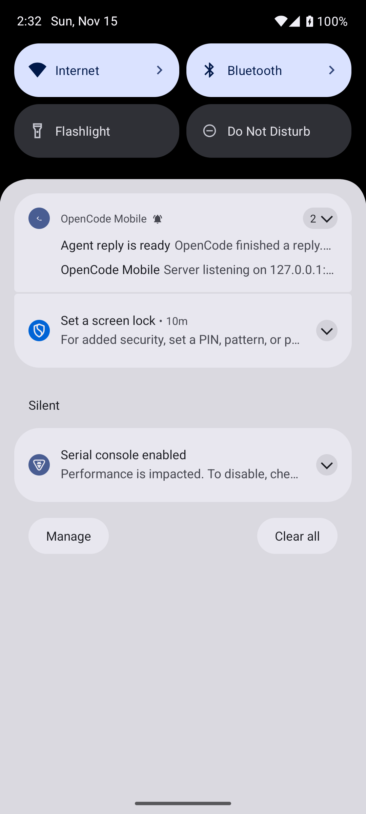
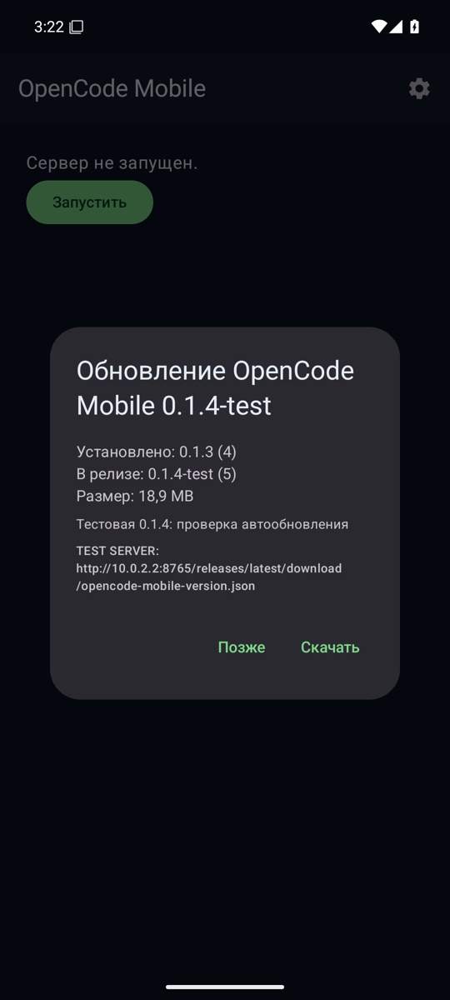
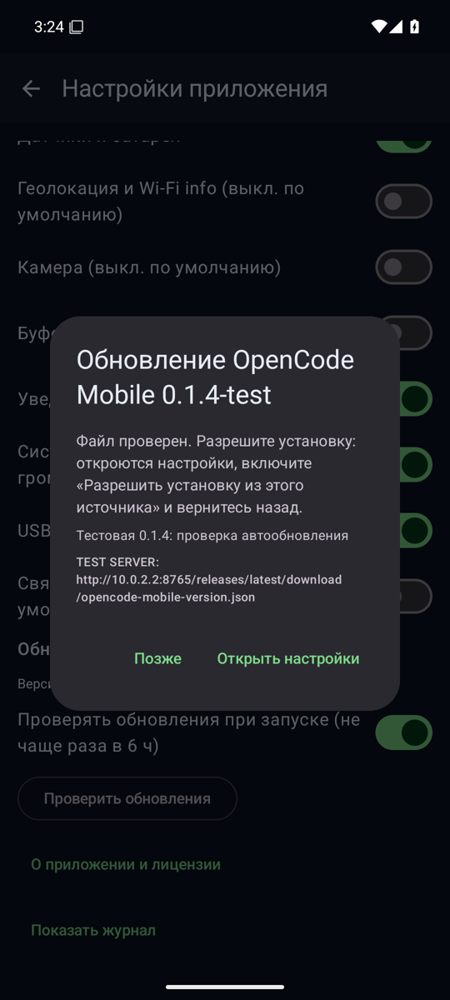
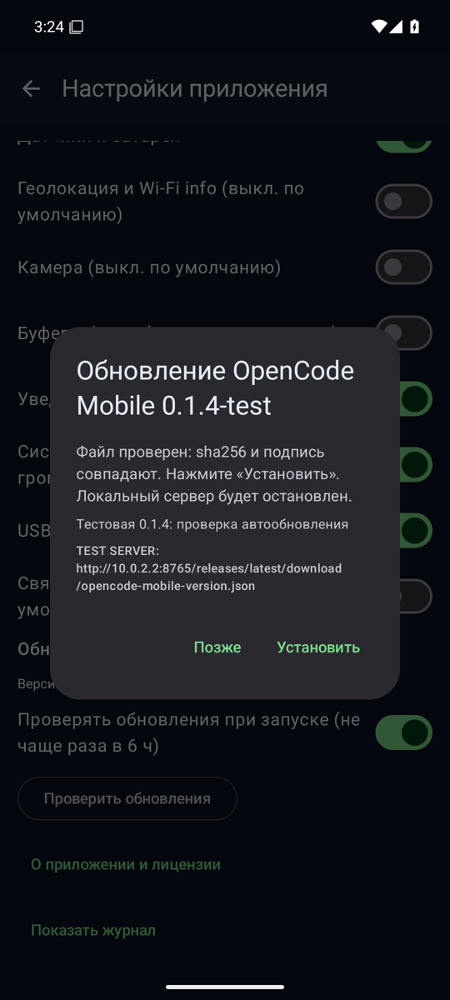
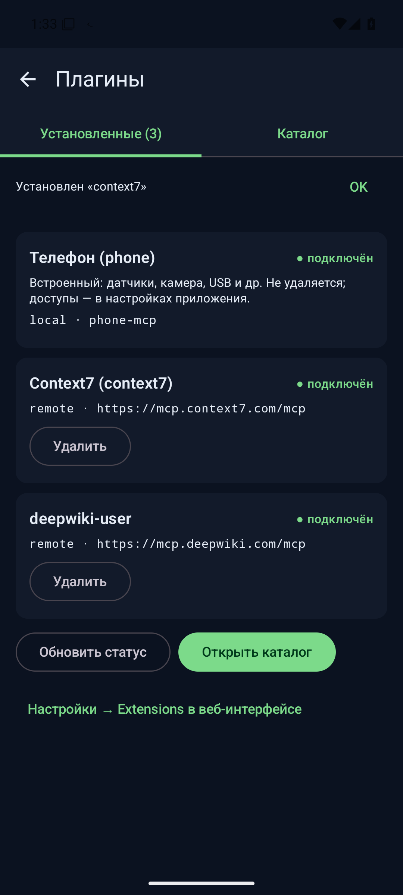
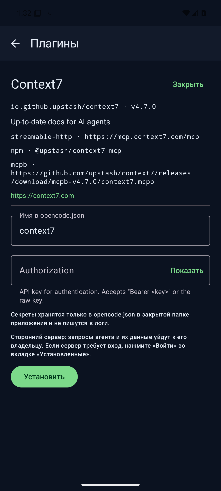
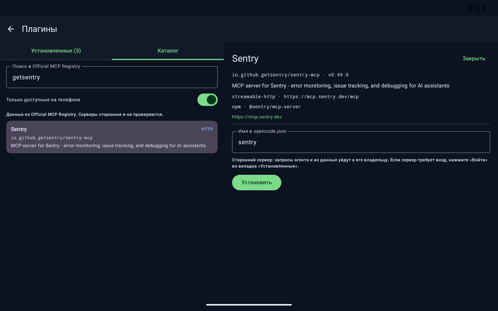

# OpenCode Mobile

Неофициальный Android-клиент для [OpenCode](https://opencode.ai). **Это не продукт команды OpenCode** и не связан с Anomaly / SST / opencode.ai.

Приложение поднимает официальный Linux-бинарник `opencode serve` (linux-arm64 или linux-x64) в среде Ubuntu 24.04 через PRoot и показывает **официальный веб-UI** во встроенном WebView. Есть встроенный Phone API (имена команд совместимы с Termux:API, плюс MCP-сервер `phone`), чтобы агент мог работать с датчиками и функциями устройства.

Пакет: `ru.dredd20.opencode`. Текущий выпуск: **0.3.0** (versionCode 12). Сборки в этом дереве — **debug**.

[English README](README.en.md) · [Список изменений](CHANGELOG.md) · [Лицензии третьих сторон](NOTICE)

## Что умеет 0.3.0

- Встроенный режим: Ubuntu 24.04 + официальный OpenCode 2.3.0 в PRoot, вход в веб-UI без ручного ввода пароля (нативный `/api/pair` + `/auth/connect/{code}`).
- Режимы Termux и Remote (подключение к уже запущенному `opencode serve`).
- Phone API и MCP `phone` (батарея, сенсоры, фонарик, буфер, toast, TTS, share, USB и др.). Чувствительные категории (геолокация, фото, SMS/контакты, NFC) по умолчанию выключены.
- **Hardware API (с 0.3.0).** USB Host (serial, HID, raw transfer), сессии с железом (`expect`, журнал), Bluetooth LE и SPP, Wi-Fi scan/connect и сетевая диагностика, NFC на переднем плане, захват кадров CameraX с уведомлением. Подробности в разделе [Hardware API](#hardware-api).
- Уведомление «ответ агента готов», когда приложение в фоне и сессия завершила ход (`session.idle` / `session.execution.succeeded`).
- Телефонный и планшетный layout (широкие настройки при ширине ≥ 840 dp).
- Автообновление из GitHub Releases этого репозитория (с 0.1.3): проверка sha256 и подписи, установка через системный установщик.
- **Плагины (с 0.2.0).** Экран «Плагины» (значок пазла сверху или «Настройки приложения → Плагины»): каталог удалённых MCP-серверов из Official MCP Registry с поиском, кэшем и офлайн-режимом, установка в один тап (запись в `opencode.json` + немедленное подключение), удаление, список установленных со статусом, поля для заголовков/ключей. Для входа через OAuth кнопка «Войти» открывает «Настройки → Расширения → MCP» в веб-UI. Встроенный `phone` не удаляется.
- `opencode.json` больше не перезаписывается при установке и запуске: приложение только дописывает свои ключи (`update`, `mcp.servers.phone`), а ваши MCP, плагины и настройки остаются. Битый файл сохраняется как `opencode.json.broken-<время>.bak`.

Пока **не** входит: локальные MCP через npx/uvx (в среде нет Node.js и uv; такие серверы в каталоге помечены «недоступно пока»), SSE-only серверы (OpenCode 2.3 подключает удалённые MCP по Streamable HTTP), вход OAuth через Custom Tabs, встроенный агентский браузер, передача raw USB fd (`termux-usb -e` / SCM_RIGHTS), прошивка ESP32 через esptool по OTG, release-подпись и публикация в магазинах.

## Установка

Распространяется как debug-APK, не через Google Play. Можно ставить поверх предыдущей 0.1.x с той же подписью, среда и `opencode.json` сохраняются.

1. Скачайте `opencode-mobile-0.3.0.apk` из [Releases](https://github.com/winnifredbalistreri60-prog/opencode-mobile/releases) (когда релиз будет опубликован) или соберите сами.
2. Разрешите установку из неизвестного источника и установите пакет.
3. На экране Setup подтвердите дисклеймер и нажмите **Install**. Нужны интернет и примерно 150 МБ сети / ~800 МБ на диске (ubuntu-base + OpenCode CLI).
4. После «Ready: OpenCode 2.3.0» нажмите **Start**. Откроется официальный веб-UI.

Пароль сервера **не** нужно вводить в страницу. Не публикуйте `serve-state.json`, `last-serve.json` и вывод `local.properties`.

### Обновление

**Из приложения (с 0.1.3).** При запуске, не чаще раза в 6 часов, приложение читает
`https://github.com/winnifredbalistreri60-prog/opencode-mobile/releases/latest/download/opencode-mobile-version.json`
(запасной путь: публичный GitHub API `releases/latest`, без токенов). Если `versionCode` в манифесте больше
установленного, появляется диалог. Вручную: **Настройки приложения → Обновления приложения → Проверить обновления**.
Там же переключатель автопроверки.

Перед установкой APK проверяется: адрес только из релизов этого репозитория, размер и sha256 из манифеста,
имя пакета, `versionCode` и сертификат подписи (должен совпасть с установленным). При любом несовпадении файл
удаляется, установка отклоняется. Установка идёт через системный PackageInstaller, Android сам спросит подтверждение.
Если нет разрешения «Установка неизвестных приложений», кнопка «Открыть настройки» ведёт на нужный экран. После
включения «Разрешить установку из этого источника» и возврата диалог сам переключается на «Установить».
Перед установкой локальный сервер останавливается. Данные (rootfs, настройки) сохраняются.

**Вручную.** Новая версия ставится поверх 0.2.x / 0.1.x, если сертификат тот же (SHA-256 `65b96eb07abe416771b1a8c96184d87641d2e1cf51954ec340d40d34b32d2a90` для этих debug-сборок). Данные rootfs сохраняются. Скрипты Phone API обновляются при каждом Start.

### Режим Termux

Нужен телефон **arm64** и Termux из F-Droid или GitHub (Termux из Google Play не подходит). Официальный OpenCode для Linux собран под glibc, а Termux живёт на Bionic, поэтому `npm i -g opencode-ai` в Termux не работает. Скрипт установки делает так:

- ставит glibc самого Termux (`glibc-repo`, `glibc-runner`) и `patchelf`;
- скачивает официальный `opencode-linux-<arch>.tar.gz` с GitHub и проверяет sha256 (для 2.3.0 суммы зашиты в скрипт);
- меняет у бинарника только ELF-интерпретатор на `$PREFIX/glibc/lib/ld-linux-*.so` (RPATH не трогает: он ломает встроенный payload);
- кладёт команду `opencode` в `$PREFIX/bin` (убирает `LD_PRELOAD` и запускает бинарник напрямую);
- включает `allow-external-apps=true` и выполняет `termux-reload-settings`.

Шаги:

1. Установите Termux и откройте его один раз.
2. В OpenCode Mobile: Настройки приложения → Режим: Termux → **«Скопировать команду установки»**. В Termux долгое нажатие → Paste, затем Enter. Скрипт сохраняется в `~/ocm-termux-install.sh`, повторный запуск безопасен и обновляет бинарник.
   Тот же скрипт лежит в репозитории: `scripts/termux-install.sh`. Когда эта версия попадёт в `main`, можно и так:
   `curl -fsSL https://raw.githubusercontent.com/winnifredbalistreri60-prog/opencode-mobile/main/scripts/termux-install.sh | bash`
3. Разрешите приложению «запускать команды в Termux» (кнопка на экране или Настройки Android → Приложения → OpenCode Mobile → Разрешения).
4. Нажмите «Запустить». Пароль сервера передаётся через stdin и файл 0600 в `~/.opencode-mobile/`, а не в аргументах. «Стоп» завершает только наш `opencode serve` (по pid и порту). Если запуск не удался, текст ошибки из Termux (stderr и код выхода) показывается на экране и пишется в `termux.log`.

Ограничение: на x86_64 Android (эмуляторы, часть Chromebook) seccomp убивает glibc-загрузчик (`Bad system call`, код 159). Там используйте встроенный режим.

При смене режима работающий сервер предыдущего режима останавливается (после подтверждения).

### Удалённый сервер

Укажите полный URL (`http://host:port` или `https://…`). Неполный адрес вроде `http://` не принимается. Для `http://` вне loopback показывается предупреждение о cleartext.


## Hardware API

С 0.3.0 поверх Phone API есть собственный Hardware API. Совместимость с именами Termux:API сохранена (`termux-usb`, `termux-wifi-scaninfo`, `termux-nfc`, `termux-camera-photo` и остальные прежние команды). Новые команды тоже доступны как CLI в rootfs и как инструменты MCP `phone`.

| Область | Команды | Заметки |
|---|---|---|
| USB Host | `termux-usb list\|permission\|open\|write\|read\|close`, `hid-read`, `hid-write`, `transfer` | Список устройств и интерфейсов, системное разрешение, USB-serial (CDC/CH340/CP210x/FTDI), HID-репорты, bulk/interrupt/control. |
| Сессия | `hw-session open\|send\|read\|expect\|log\|close` | Транспорт `usb-serial`, `bt-spp` или `tcp`. `expect` по regex, журнал в `/opencode-host/hardware/sessions/`. |
| Bluetooth | `bluetooth scan\|connect\|services\|read\|write\|notify\|disconnect`, `spp-connect\|spp-send\|spp-read\|spp-close` | BLE GATT и классический SPP. На Android 12+ нужны `BLUETOOTH_SCAN` / `BLUETOOTH_CONNECT`. |
| Wi-Fi и сеть | `termux-wifi-scaninfo`, `termux-wifi-connectioninfo`, `termux-wifi-connect`, `net ping\|dns\|port\|mdns\|tcp\|udp` | Сканирование учитывает троттлинг Android. Подключение — только с подтверждением пользователя (Android 10+). |
| NFC | `termux-nfc read\|info\|write\|transceive` | Только когда приложение на экране (`enableReaderMode`), с таймаутом ожидания метки. |
| Камера | `camera-capture`, `camera-start`, `camera-stop`, `camera-latest` | CameraX, JPEG в каталог проекта, кольцевой буфер, foreground-сервис с уведомлением. Старый `termux-camera-photo` не убран. |

Категории Bluetooth, Wi-Fi подключение и сессии с железом по умолчанию включены; NFC, камера и геолокация (вместе со сканированием Wi-Fi) выключены. Прошивка ESP32 через esptool в 0.3.0 не сделана: это следующий этап.

## Сборка из исходников

Нужны JDK 17+, Android SDK (API 35/36) и (для эмулятора) AVD x86_64.

Debug-ключ **не** хранится в git. Положите keystore вне репозитория и укажите путь в игнорируемом `local.properties`:

```
sdk.dir=/path/to/android-sdk
debug.keystore=/path/to/debug-v0.1.keystore
```

Либо задайте переменную окружения `OPENCODE_DEBUG_KEYSTORE`. Если файла нет, Gradle использует обычный debug-ключ Android (подпись не совпадёт с уже установленным 0.1.x).

```bash
./gradlew assembleDebug testDebugUnitTest
# APK: app/build/outputs/apk/debug/app-debug.apk
```

Не коммитьте `local.properties`, `*.keystore`, `*.jks`, каталоги `build/` и `.gradle/`.

### Выпуск релиза (для сопровождающего)

`scripts/make-release.sh` собирает APK, проверяет сертификат подписи, считает sha256 и пишет
`dist/v<версия>/opencode-mobile-<версия>.apk`, `.sha256` и `opencode-mobile-version.json`. Скрипт ничего не публикует.
Оба файла (APK и `opencode-mobile-version.json`) загружаются в релиз `v<версия>`, релиз помечается как latest.
Тестовые сборки с `-PocmUpdateTestServer=http://…` (локальный сервер обновлений) скрипт отказывается выпускать.

## Скриншоты

| Веб-UI после обновления | Ответ модели | Уведомление о готовом ответе |
| --- | --- | --- |
|  |  |  |

| Найдено обновление | Нужно разрешение | После разрешения |
| --- | --- | --- |
|  |  |  |

### Плагины (MCP)

- Каталог берётся из [Official MCP Registry](https://registry.modelcontextprotocol.io) (`/v0.1/servers`, только последние версии). Это сторонние серверы, реестр их не проверяет: запросы агента уйдут к владельцу сервера.
- По умолчанию показаны только серверы, которые можно поставить на телефоне (удалённый Streamable HTTP). Переключатель «Только доступные на телефоне» показывает остальные с причиной.
- Установка во встроенном режиме сохраняется в `/root/.config/opencode/opencode.json` внутри закрытой папки приложения (права 0600) и переживает перезапуск сервера и обновление APK. Значения заголовков (API-ключи) хранятся только там и не пишутся в журналы.
- В режимах Termux и «Удалённый сервер» конфиг сервера приложению не принадлежит: установка действует до перезапуска сервера.

| Установленные | Карточка сервера | Планшет |
| --- | --- | --- |
|  |  |  |

## Документация

- [CHANGELOG.md](CHANGELOG.md) — 0.1.0, 0.1.1, 0.1.2
- [CHANGES.md](CHANGES.md) — подробности исправлений текущего выпуска по багам тестера
- [TESTPLAN.md](TESTPLAN.md) — как проверять
- [NOTICE](NOTICE) / [THIRD_PARTY.md](THIRD_PARTY.md) — третьи стороны
- [LICENSE](LICENSE) — MIT, с атрибуцией [anomalyco/opencode](https://github.com/anomalyco/opencode)

## Сообщения об ошибках

Пожалуйста, используйте [шаблоны Issues](.github/ISSUE_TEMPLATE). Не прикладывайте пароли, keystore и `local.properties`. Ошибки самого CLI / веб-UI OpenCode лучше слать [upstream](https://github.com/anomalyco/opencode).

## Лицензия

Код клиента — MIT, © 2026 OpenCode Mobile contributors. OpenCode — MIT, © 2025 opencode / Anomaly. PRoot (форк Termux) — GPL-2.0-or-later; talloc — LGPL-3.0-or-later; подробности в `NOTICE`.
